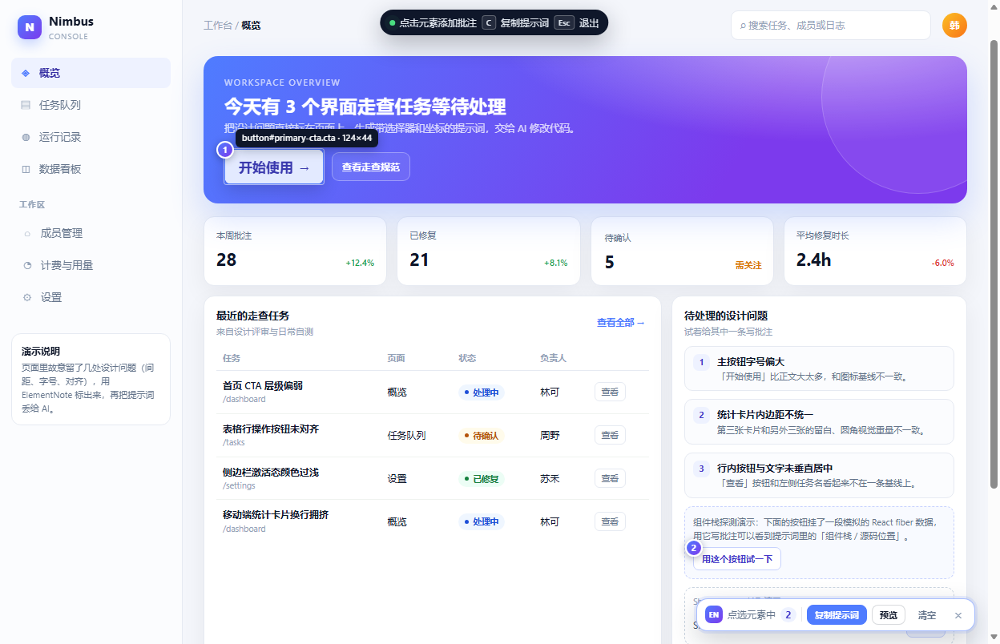

# ElementNote

**Select any UI element → write a note → copy a structured AI prompt.**

[中文 README](README.md) · [Latest release](https://github.com/N20xDuli/elementnote/releases/latest) · [Demo](demo/index.html)

[](LICENSE)
[](manifest.json)
[](#install)
[](#install)



ElementNote is a local-first browser extension for frontend developers and designers. It works like DevTools' element picker: select any element, write a note, and copy a Markdown prompt containing the page URL, CSS selector, XPath, coordinates, computed styles, and (when detectable) the React/Vue/Angular component stack. Paste it into ChatGPT, Claude, Cursor, Copilot, DeepSeek, Gemini, or any coding agent to fix the UI without re-describing where the element is.

No account. No telemetry. No network requests.

## Features

- **Element picker** — `Alt+Shift+C` (or toolbar → Start annotating), hover highlight, click to select, `Esc` to exit.
- **Annotations** — type a note, `Enter` to save; numbered badges stay on the page; click a badge to edit.
- **Structured context** — URL, title, viewport, scroll, CSS selector, XPath, parent path, siblings, text, HTML snippet, attributes, document/viewport coordinates, size, and selected computed styles.
- **Component stack** — best-effort React / Vue / Angular component names and source locations via a read-only main-world probe.
- **Shadow DOM** — pick elements inside open shadow roots; selectors use `host >> inner path`.
- **iframe containers** — annotate the iframe element itself; internals are not collected.
- **Copy prompt** — press `C`, use the toolbar, or copy from the extension popup.
- **Annotation manager** — per-page groups, locate, edit, delete, clear; per-URL storage so different tabs do not overwrite each other.
- **Cross-browser** — one Manifest V3 codebase: Chrome/Edge (`service_worker`) and Firefox (`background.scripts`).

## Install

### Chrome / Edge (121+)

1. Download the [latest release](https://github.com/N20xDuli/elementnote/releases/latest).
2. Open `chrome://extensions` (Edge: `edge://extensions`) → enable Developer mode.
3. **Load unpacked** → select the repository root (or the unzipped `elementnote/` folder).
4. Pin the extension.

### Firefox (140+)

- **Temporary**: open `about:debugging#/runtime/this-firefox` → **Load Temporary Add-on** → select `elementnote-firefox.xpi`. It disappears when Firefox restarts.
- **Permanent**: Mozilla only keeps signed add-ons. Use the AMO self-distribution flow in [`store/amo/SUBMIT.md`](store/amo/SUBMIT.md); after signing, install the signed XPI via `about:addons` → gear → **Install Add-on From File**.

## Usage

1. Open any `http(s)` page (a local dev server works great).
2. Press `Alt+Shift+C` or click the toolbar icon → **Start annotating**.
3. Hover and click an element, write the problem/expectation, press `Enter`.
4. Press `C` or click **Copy prompt**.
5. Paste into your AI assistant.
6. Click the toolbar icon to manage annotations: locate, edit, delete, clear, copy per page.

Try the bundled demo:

```bash
cd demo
python -m http.server 8000
# open http://localhost:8000
```

## What the prompt looks like

See a real example: [`docs/prompt-example.md`](docs/prompt-example.md).

```markdown
## 页面信息
- 地址：http://127.0.0.1:58675/index.html
- 视口：1248 × 804（devicePixelRatio 1），滚动位置 (0, 0)
- 批注数量：2

### 批注 1
**批注内容**：主按钮字号偏大，和右侧图标基线不齐，改成 14px 并与图标垂直居中

- CSS 选择器：`#primary-cta`
- XPath：`//*[@id="primary-cta"]`
- 位置：文档坐标 (280, 232)，尺寸 124 × 44 px
- 父级路径：`body > div.shell > main.main > section.hero > div.hero-actions`
- 计算样式：`display: flex; font-size: 17px; background-color: rgb(255, 255, 255); …`
- 组件栈：React `CardActions > DashboardPage`，源码 `src/pages/Dashboard.tsx:42:7`
```

## Privacy

- No network requests, no account, no analytics, no remote code.
- Page text/HTML/attributes/styles are stored only in `browser.storage.local`.
- Data leaves the browser only when you explicitly copy a prompt and paste it elsewhere.
- AMO data collection declaration: `required: ["none"]`.
- Full policy: [`store/amo/privacy-policy.md`](store/amo/privacy-policy.md).

## Compatibility and limitations

| Case | Status |
|---|---|
| Chrome / Edge 121+ | Supported |
| Firefox 140+ | Supported (tested on Firefox 159) |
| `chrome://`, `edge://`, `about:`, add-on stores, PDF viewer | Not available by browser design |
| iframe internals | Not collected; the iframe container itself can be annotated |
| Shadow DOM | Open shadow roots only; closed roots are inaccessible |
| SPA routing | path/query and `#/route` hash routes are grouped; plain anchors are not |
| Two tabs editing the same URL | Last write wins |
| `file://` | Requires allowing file access in the extension settings |

## Development and testing

```bash
# Chromium E2E (Edge; headless, writes fresh docs screenshots)
node tests/e2e.mjs

# Firefox AMO/Firefox package
python tools/build_amo_xpi.py . store/amo/elementnote-1.0.0.xpi

# Firefox linter
npx web-ext@latest lint --source-dir . --output json
```

No build step, no dependencies, plain JavaScript. See [`CONTRIBUTING.md`](CONTRIBUTING.md) and [`SECURITY.md`](SECURITY.md).

## Keywords

browser extension, Chrome extension, Edge extension, Firefox add-on, Manifest V3, element picker, inspect element, CSS selector, XPath, computed styles, UI annotation, design review, frontend debugging, AI prompt, prompt engineering, AI coding assistant, Cursor, Claude Code, GitHub Copilot, ChatGPT, DeepSeek, Gemini, React component stack, Vue component stack, Shadow DOM, Web Components, iframe annotation, bug reporting, developer tools, local-first.

## License

MIT © 2026 N20xDuli. See [`LICENSE`](LICENSE).
