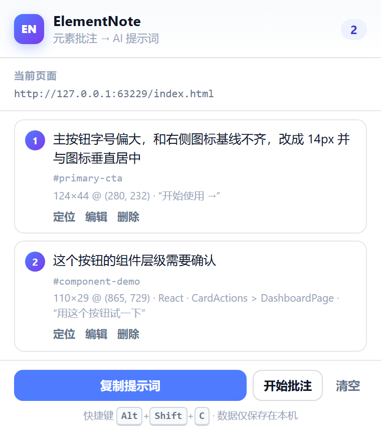

# ElementNote

**Pick any UI element → write a note → copy a structured AI prompt.**
**像 DevTools 一样选中页面元素，写下批注，一键生成带定位信息的 AI 提示词。**

[](LICENSE)
[](manifest.json)
[](#chrome--edge)
[](#firefox)
[](#privacy--permissions)
[](#testing)
[](store/amo/SUBMIT.md)

[English](#english-quick-start) · [中文](#中文说明) · [Features](#features--功能) · [Install](#install--安装) · [Usage](#usage--使用) · [Privacy](#privacy--permissions) · [FAQ](#faq--常见问题) · [Keywords](#keywords--关联词)


ElementNote is a **local-first browser extension** for frontend developers and designers. Select an element like DevTools' `Ctrl+Shift+C` picker, write a note, and copy a Markdown prompt containing the page URL, CSS selector, XPath, coordinates, computed styles, and (when detectable) the React/Vue/Angular component stack. Paste it into ChatGPT, Claude, Cursor, Copilot, DeepSeek, Gemini, or any coding agent to fix the UI without re-describing where the element is.

No account. No telemetry. No network requests. Works on Chrome, Edge, and Firefox (Manifest V3), with open Shadow DOM and iframe-container support.

---

## English quick start

1. Install the extension:
   - **Chrome / Edge**: download the latest release ZIP, unzip, then `chrome://extensions` → Developer mode → **Load unpacked** → select the folder.
   - **Firefox 140+**: temporary load `elementnote-firefox.xpi` from [about:debugging](about:debugging#/runtime/this-firefox), or use the AMO-signed build (see [`store/amo/SUBMIT.md`](store/amo/SUBMIT.md)).
2. Open any `http(s)` page (local dev server is ideal).
3. Press **`Alt+Shift+C`** or click the toolbar icon → *Start annotating*.
4. Hover and click an element, type a note, press **`Enter`**.
5. Press **`C`** (or click *Copy prompt*), then paste into your AI assistant.
6. Press **`Esc`** to exit; click a numbered badge to edit an annotation.

The prompt contains the page URL, CSS selector, XPath, parent path, siblings, coordinates, computed styles, and component stack (best effort). See a real generated example: [`docs/prompt-example.md`](docs/prompt-example.md).

---

## 中文说明

ElementNote 是给前端开发、设计走查和 UI 调试用的「页面元素批注 → AI 提示词」工具。

你有没有经历过：发现页面某个按钮字号不对、间距不一致、颜色偏了，截图丢给 AI，还要手打「这是首页 hero 区的按钮，文件大概在 components 里」？ElementNote 把这一步自动化：

- 在任意页面上选中元素；
- 写下问题或期望；
- 一键复制一段结构化 Markdown，包含 **页面 URL、CSS 选择器、XPath、父级路径、元素文本、HTML 片段、属性、文档/视口坐标、尺寸、计算样式、React/Vue/Angular 组件栈与源码位置**；
- 粘给 AI 改代码。

### 目录

- [为什么做这个](#为什么做这个)
- [功能](#features--功能)
- [安装](#install--安装)
- [使用](#usage--使用)
- [提示词示例](#prompt-example--提示词示例)
- [数据与隐私](#privacy--permissions)
- [兼容性与限制](#compatibility--limitations)
- [架构](#architecture--架构)
- [开发与测试](#testing)
- [AMO / Firefox 上架](#amo--firefox-signing)
- [FAQ](#faq--常见问题)
- [关键词](#keywords--关联词)
- [贡献](#contributing)

---

## 为什么做这个

调研了现成方案（完整报告见 [`docs/existing-solutions.md`](docs/existing-solutions.md)）。结论：没有找到同时满足「任意站点 + 纯本地 + 无需账号 + 批注 + 一键复制含 URL/选择器/坐标的提示词」的现成插件。

| 方案 | 能做什么 | 为什么不直接用 |
|---|---|---|
| [react-grab](https://github.com/aidenybai/react-grab) | 选中 React 元素，复制组件栈 + 源码位置给编码 agent | 仅 React、需改项目构建、无 URL/选择器/坐标、没有批注框 |
| [stagewise](https://github.com/stagewise-io/stagewise) | 内置浏览器 + agent，选中元素把上下文喂给 agent | 已转型 Agentic IDE，不产出可复制提示词 |
| [Browser MCP](https://browsermcp.io/) | 让 AI 通过 MCP 操作浏览器 | 方向相反：AI 控制浏览器 |
| BugHerd / Pastel / MarkUp.io / Userback | 可视化批注、截图、任务看板 | SaaS 账号 + 云端，批注进看板，不生成提示词 |
| DevTools Copy selector | 复制选择器或 DOM 片段 | 无批注、无坐标、无模板，仍需手工拼提示词 |

ElementNote 的差异点：**把「哪里」和「要什么」压缩成一段 AI 能直接执行的文本**，纯本地、跨浏览器、零账号。

---

## Features / 功能

- **元素拾取**：`Alt+Shift+C` 或弹窗按钮进入拾取模式；悬停高亮并显示 `标签#id.class · 宽×高`；点击选中；`Esc` 退出。
- **批注**：浮层输入问题/期望；`Enter` 保存、`Shift+Enter` 换行；数字徽标钉在元素上；点徽标可编辑、删除。
- **定位信息采集**：
  - 页面 URL / 标题 / 视口 / DPR / 滚动位置
  - CSS 选择器（唯一 id → `data-testid` → 唯一 class → id 祖先锚定 → 最短唯一路径）
  - XPath、父级路径、兄弟节点、文本、HTML 片段、关键属性
  - 文档坐标 + 视口坐标 + 尺寸
  - 计算样式（布局、字体、颜色、边框、圆角、阴影、z-index 等）
  - React / Vue / Angular 组件栈与源码位置（页面主世界只读探测，失败静默降级）
- **Shadow DOM**：逐层进入 open shadow root 命中内部元素；选择器记录为 `宿主 >> 内部路径`。
- **iframe**：iframe 容器本身可选中并批注；内部文档不采集。
- **提示词**：结构化 Markdown，可预览、编辑后复制；页面内 `C`、工具栏或扩展弹窗都能复制。
- **批注管理**：按页面 URL 分组；定位、编辑、删除、清空；刷新/切页不丢；不同页面分片存储，多标签并发保存互不覆盖。
- **隐私**：无网络请求、无账号、无统计；数据只存 `chrome.storage.local`。
- **跨浏览器**：同一份 manifest 同时支持 Chrome/Edge（`service_worker`）和 Firefox（`background.scripts` event page）。

| 页面内 | 扩展弹窗 |
|---|---|
|  |  |

---

## Install / 安装

### Chrome / Edge

要求 **Chrome/Edge 121+**（Manifest V3）。

**方式 A：从源码加载（推荐开发者）**

1. 下载仓库或 [最新 Release](https://github.com/N20xDuli/elementnote/releases/latest)；
2. 打开 `chrome://extensions`（Edge：`edge://extensions`）；
3. 开启右上角 **开发者模式**；
4. **加载已解压的扩展程序** → 选择仓库根目录（含 `manifest.json`）；
5. 建议固定到工具栏。

**方式 B：Release ZIP**：下载 `elementnote-1.0.0.zip`，解压后选择解压出的 `elementnote/` 文件夹。

> Manifest 同时声明了 `service_worker` 与 `scripts`；Chrome 121+ 会忽略 `scripts`，Firefox 会使用 `scripts`。

### Firefox

要求 **Firefox 140+**。

**临时安装（开发用）**

1. 打开 `about:debugging#/runtime/this-firefox`；
2. **临时载入附加组件** → 选择 `elementnote-firefox.xpi`；
3. 允许「访问所有网站的数据」；
4. 注意：临时扩展在 **Firefox 重启/更新后消失**，这是 Firefox 机制，不是插件过期。

**永久安装（必须签名）**

Mozilla 只允许已签名扩展永久安装，签名免费，但需要你本人 Mozilla 账号在 [AMO Developer Hub](https://addons.mozilla.org/developers/) 提交。完整材料与步骤见 [`store/amo/SUBMIT.md`](store/amo/SUBMIT.md)。

- **自签名 / unlisted**（最快）：AMO → Submit a New Add-on → On your own → 上传 `store/amo/elementnote-1.0.0.xpi` → 下载签名 XPI → `about:addons` → 齿轮 → **Install Add-on From File**。
- **公开上架**：同一入口选择 listed，按 [`store/amo/listing.md`](store/amo/listing.md) 填 listing 并提交审核。

### 快捷键

- 默认 **`Alt+Shift+C`** 开始/退出批注。
- 修改：Chrome/Edge `chrome://extensions/shortcuts`；Firefox `about:addons` → 齿轮 → 管理扩展快捷键。
- `Ctrl+Shift+C` 被 DevTools 的「检查元素」占用，默认避开；如果设置页提示冲突，换一个组合。
- 也可以点扩展图标 → **开始批注**，不依赖快捷键。

---

## Usage / 使用

1. 打开任意前端页面（localhost、内网、线上均可）。
2. `Alt+Shift+C` 或扩展图标 →「开始批注」。
3. 移动鼠标高亮，点击目标元素。
4. 写批注，`Enter` 保存；页面出现数字徽标。
5. 按 `C` 或点「复制提示词」；粘贴给 AI。
6. 点扩展图标查看批注列表：定位、编辑、删除、清空、跨页面复制。

页面内快捷键：`Esc` 退出批注；工具栏 `×` 隐藏；「清空」需点两次确认。

### Quick demo

```powershell
cd demo
python -m http.server 8000
# or: npx serve .
```

打开 <http://localhost:8000>，按 `Alt+Shift+C`，点「开始使用」，写批注，按 `C`。

> 直接双击 `demo/index.html`（`file://`）也可以，但需在扩展详情页打开 **允许访问文件网址**（Firefox 也需授予文件访问权限）。

---

## Prompt example / 提示词示例

完整真实示例：[`docs/prompt-example.md`](docs/prompt-example.md)。节选：

```markdown
## 页面信息
- 地址：http://127.0.0.1:58675/index.html
- 标题：Nimbus 控制台 · ElementNote 演示
- 视口：1248 × 804（devicePixelRatio 1），滚动位置 (0, 0)
- 批注数量：2
- 环境：本地开发页面（localhost / 内网地址）

### 批注 1
**批注内容**：主按钮字号偏大，和右侧图标基线不齐，改成 14px 并与图标垂直居中

- 元素：`<button class="cta" id="primary-cta" data-testid="hero-cta">…</button>`
- CSS 选择器：`#primary-cta`
- XPath：`//*[@id="primary-cta"]`
- 位置：文档坐标 (280, 232)，尺寸 124 × 44 px；选中时视口坐标 (280, 232)
- 父级路径：`body > div.shell > main.main > section.hero > div.hero-actions`
- 同级元素：父级下共 2 个元素，自身第 1 个；相邻：`button#hero-doc.hero-link "查看走查规范"`
- 关键属性：`data-testid="hero-cta"`
- 计算样式：`display: flex; … font-size: 17px; … background-color: rgb(255, 255, 255); …`
- 组件栈：React `CardActions > DashboardPage`，源码 `src/pages/Dashboard.tsx:42:7`
```

末尾会给 AI 明确任务要求：先用选择器/组件栈定位、逐条说明文件和改动、视觉问题结合计算样式给具体数值、信息不足先追问、不要臆造文件。

---

## Privacy / permissions

| 权限 | 用途 |
|---|---|
| `storage` | 在本机保存批注与元素定位信息（`chrome.storage.local` / `browser.storage.local`） |
| `clipboardWrite` | 一键复制提示词 |
| `scripting` | 在页面主世界**只读**读取 React/Vue/Angular 组件栈 |
| `host_permissions: <all_urls>` | 在任意页面的内容脚本中运行拾取器；只在本机处理，不上传 |

- **没有网络请求**：源码中没有 `fetch` / XHR / WebSocket / `sendBeacon` / 远程脚本 / `eval` / `new Function`。
- **数据不离开浏览器**：页面文本、HTML、属性、样式、坐标只写本地 storage；只有你主动复制提示词并粘贴到第三方 AI 时，内容才离开浏览器。
- **删除**：可在扩展里逐条删除/清空；卸载扩展会清空 storage。
- AMO 数据声明：`data_collection_permissions.required = ["none"]`。详见 [`store/amo/privacy-policy.md`](store/amo/privacy-policy.md)。
- 敏感页面请谨慎：提示词可能包含页面文字/属性值。

---

## Compatibility / limitations

| 场景 | 情况 |
|---|---|
| Chrome / Edge 121+ | 支持 |
| Firefox 140+ | 支持（Firefox 159 实测 17 项） |
| `chrome://`、`edge://`、`about:`、扩展商店、PDF 阅读器 | 浏览器禁止扩展运行 |
| iframe | 容器本身可批注；**内部元素不采集** |
| Web Components / Shadow DOM | open shadow root 可拾取/读组件栈；closed shadow root 不可访问 |
| SPA 路由 | path/query 与 `#/route`、`#!/route` 分组；纯锚点 `#section` 不分页 |
| 同一 URL 双标签同时写入 | 以最后保存为准（分片只到 URL 粒度） |
| 元素漂移 | 以选择器/XPath 为准；坐标是选中时快照 |
| hover 样式 | 批注面板打开时用透明遮罩隔离 `:hover`；active/动画状态仍可能影响个别值 |
| Firefox 临时扩展 | 重启/更新后消失；永久使用需 AMO 签名 |
| Firefox 权限 | 拒绝「访问所有网站的数据」会导致内容脚本不注入 |

---

## Architecture / 架构

```
┌──────────────────────────────┐
│ popup (src/popup.*)          │  按页面分组、定位、编辑、删除、复制
└──────────────┬───────────────┘
               │ messages
┌──────────────▼───────────────┐        ┌──────────────────────────┐
│ content script (src/content) │◄──────►│ background.js            │
│  · element picker           │ probe  │  · shortcut / toggle     │
│  · Shadow DOM annotation UI │        │  · MAIN-world component  │
│  · DOM/context collection   │        │    probe (React/Vue/...) │
│  · prompt preview/copy      │        └──────────────────────────┘
└──────────────┬───────────────┘
               │
┌──────────────▼───────────────┐
│ src/lib/prompt.js            │  纯函数 Markdown 生成器
└──────────────┬───────────────┘
               │
┌──────────────▼───────────────┐
│ storage.local (per-URL keys) │  本地持久化，无网络
└──────────────────────────────┘
```

- 内容脚本运行在隔离世界；组件栈探测通过 `scripting.executeScript({ world: "MAIN" })` 在页面主世界只读执行。
- UI 使用 Shadow DOM + constructable stylesheet 隔离页面样式，避免污染。
- `manifest.json` 同时声明两种后台模型，实现 Chrome/Edge/Firefox 同一份代码。

---

## Testing

**Chromium E2E：73 项断言**

```powershell
# 需要 Edge（或 Chromium 浏览器）
node tests/e2e.mjs

# 指定浏览器路径
set ELEMENTNOTE_BROWSER=C:\Program Files (x86)\Microsoft\Edge\Application\msedge.exe
node tests/e2e.mjs
```

测试覆盖：内容脚本注入、快捷键/消息激活、悬停高亮、真实鼠标点击、Shadow DOM 拾取、iframe 容器、空批注拦截、hash 路由分组、保存/持久化、分片 storage、真实点击保存/预览/徽标编辑、`:hover` 样式隔离、React 组件栈、提示词字段、`C` 复制与剪贴板内容比对、刷新恢复、popup 渲染/复制、定位、截图。

**Firefox 真机验证：17 项**

Firefox 159 + Marionette 临时安装 XPI，验证：内容脚本注入、扩展页激活、真实指针点击、两条批注、提示词 URL/选择器/组件栈、`C` 复制到剪贴板并读取比对、分片 storage。

**Lint**

```powershell
npx web-ext@latest lint --source-dir . --output json
# 0 errors；3-4 个可解释 warning（跨浏览器双后台、Android 版本、静态 innerHTML 模板）
```

> 为什么用 Edge 跑 Chromium 测试：Chrome 137+ 品牌版禁用了命令行 `--load-extension`（Chrome for Testing / Edge 仍可用），手动加载不受影响。两者同为 Chromium/MV3。

---

## AMO / Firefox signing

Firefox 只允许已签名扩展永久安装。AMO 提交材料已准备：

- 提交指南：[`store/amo/SUBMIT.md`](store/amo/SUBMIT.md)
- 上传 XPI：[`store/amo/elementnote-1.0.0.xpi`](store/amo/elementnote-1.0.0.xpi)
- 上架文案：[`store/amo/listing.md`](store/amo/listing.md)
- 隐私政策：[`store/amo/privacy-policy.md`](store/amo/privacy-policy.md)
- 审核说明：[`store/amo/reviewer-notes.md`](store/amo/reviewer-notes.md)
- 截图：[`store/amo/screenshots/`](store/amo/screenshots/)

> 2025-11-03 起 AMO 要求新提交扩展声明 `data_collection_permissions`；本项目已声明 `required: ["none"]`。当前状态：**提交材料就绪，尚未上架**。

---

## FAQ / 常见问题

**Q：Firefox 临时插件为什么几天后消失了？**
A：临时附加组件只保留到下一次 Firefox 重启/更新。普通 Firefox 只允许安装 Mozilla 签名的 XPI。用 AMO 自签名（unlisted）即可永久安装，见 [`store/amo/SUBMIT.md`](store/amo/SUBMIT.md)。

**Q：为什么需要「访问所有网站」权限？**
A：这是元素拾取器的核心：你需要在任意前端页面上选元素。内容脚本只在本机读取 DOM 并在你操作后显示 UI，不上传数据。

**Q：会把我页面的数据上传吗？**
A：不会。扩展没有任何网络请求；只有你主动复制提示词并粘贴到第三方 AI 时，内容才离开浏览器。

**Q：支持 Vue / Angular / React 吗？**
A：都能用基础拾取/定位；组件栈是 best-effort：React fiber、Vue 实例、Angular dev mode；探测不到时静默降级，不影响提示词。

**Q：支持本地开发页面吗？**
A：支持 http(s)、localhost、内网 IP；`file://` 需在扩展设置里授权文件访问。

**Q：和截图批注工具（BugHerd / Pastel）有什么区别？**
A：它们把批注存到云端看板；ElementNote 生成可直接粘给 AI 的**结构化代码定位上下文**，纯本地、无账号。

**Q：能用在 Chrome Web Store / AMO 上吗？**
A：Chrome/Edge 可从源码或 Release 加载；Firefox 正在准备 AMO 签名/上架（材料已就绪，尚未 listed）。

---

## Keywords / 关联词

**English**: browser extension, Chrome extension, Edge extension, Firefox add-on, Manifest V3, element picker, inspect element, DevTools alternative, CSS selector, XPath, computed styles, element coordinates, UI annotation, design review, frontend debugging, frontend development, web development, AI prompt, prompt engineering, AI coding assistant, AI agent context, Cursor, Claude Code, GitHub Copilot, ChatGPT, DeepSeek, Gemini, React component stack, Vue component stack, Angular, Shadow DOM, Web Components, iframe annotation, bug reporting, visual feedback, developer tools, productivity, local-first, privacy-first.

**中文**: 浏览器插件、Chrome 扩展、Edge 扩展、Firefox 附加组件、Manifest V3、元素选择器、检查元素、CSS 选择器、XPath、计算样式、元素坐标、页面批注、UI 走查、设计走查、前端调试、前端开发、Web 开发、AI 提示词、提示词工程、AI 编程助手、AI 上下文、Cursor、Claude Code、GitHub Copilot、ChatGPT、DeepSeek、Gemini、React 组件栈、Vue 组件栈、Angular、Shadow DOM、Web Components、iframe 批注、Bug 反馈、可视化反馈、开发者工具、效率工具、纯本地、隐私优先。

---

## Contributing

欢迎 issue / PR：bug、兼容性、提示词模板、新的框架探测、文档翻译。

- 开发：`chrome://extensions` 加载本目录；改完点刷新。
- 测试：`node tests/e2e.mjs`（Chromium）；Firefox 见 `store/amo/SUBMIT.md`。
- 代码风格：原生 JS，无构建步骤；不引入远程代码；不新增网络请求。
- 详细见 [`CONTRIBUTING.md`](CONTRIBUTING.md)，安全问题见 [`SECURITY.md`](SECURITY.md)。

如果这个工具帮你省了时间，欢迎点一个 ⭐ Star，或者把它分享给正在做前端走查的同事。

---

## License

MIT © 2026 N20xDuli · 见 [`LICENSE`](LICENSE)。

第三方商标（Chrome、Edge、Firefox、React、Vue、Cursor、Claude、ChatGPT 等）归各自所有者，仅用于说明兼容性。
